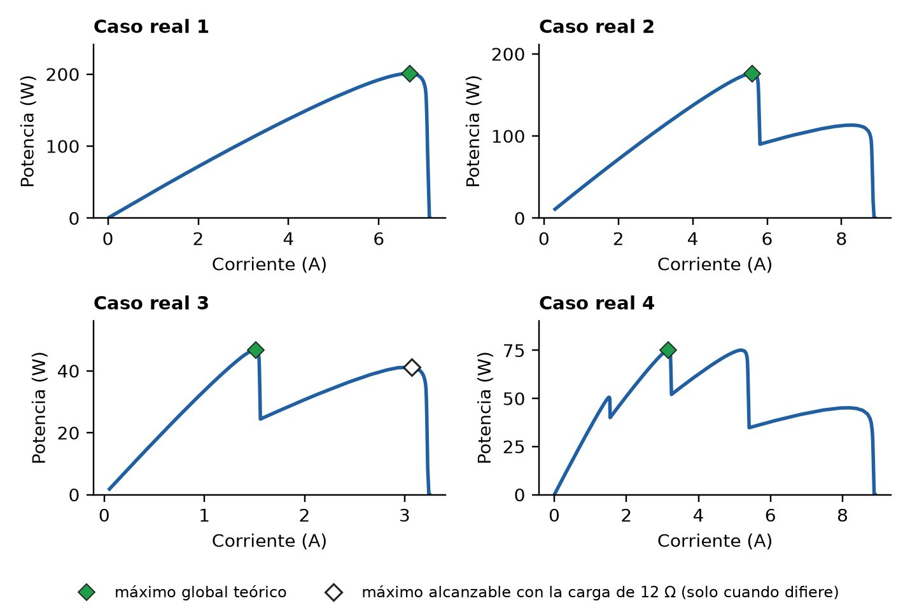
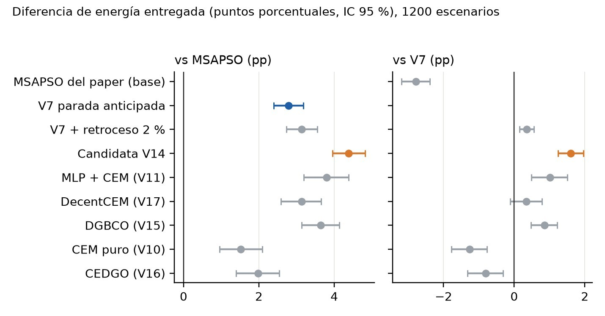
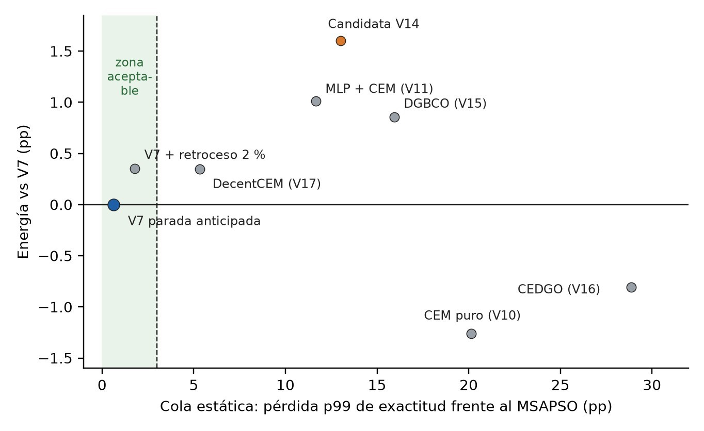
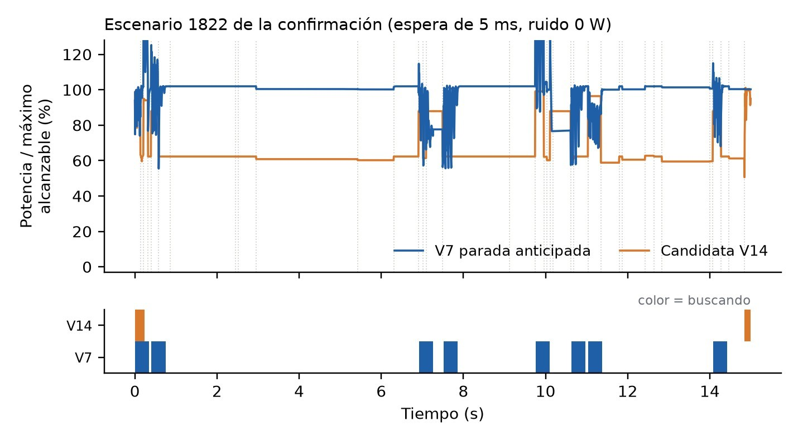
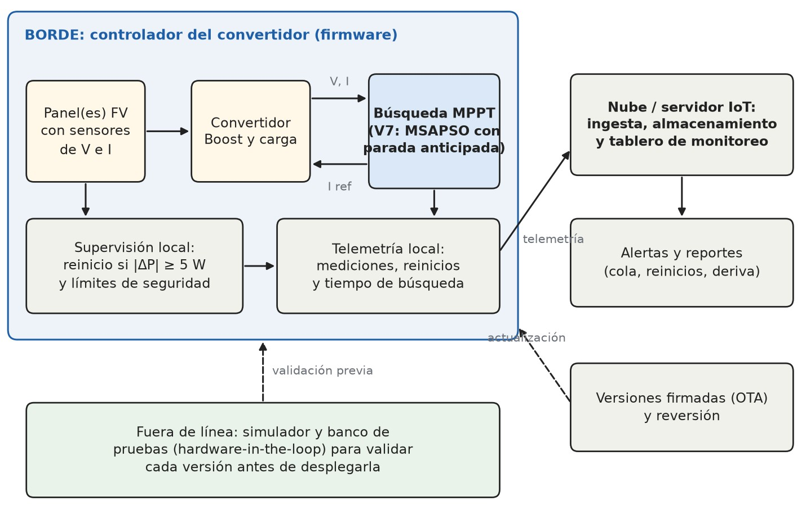

**Tecnológico de Monterrey**

# Parada anticipada del MSAPSO frente a alternativas de aprendizaje y optimización para el seguimiento del punto de máxima potencia bajo sombreado parcial

**Autores:** P. C. Márquez Correo, D. Molina León, F. Moreira Guerra  
**Proyecto:** Proyecto Integrador — Maestría en Inteligencia Artificial Aplicada  
**Institución:** Tecnológico de Monterrey  
**Asesor:** Prof. Gerardo J. Camacho González, PhD  
**Equipo:** Equipo 53 Solar Optimization  
**Fecha:** 14 de noviembre de 2026  

---

## Resumen

El seguimiento del punto de máxima potencia (MPPT) bajo sombreado parcial es difícil porque la curva potencia-corriente tiene varios máximos locales. Este trabajo exploratorio, sin fin comercial, parte del MSAPSO, un enjambre de siete partículas que usa 175 mediciones por búsqueda, y pregunta si es posible superarlo con aprendizaje por refuerzo, redes neuronales u optimización poblacional. Todas las versiones (V2 a V19) se compararon con el mismo simulador dinámico (convertidor Boost con control Super-Twisting), la energía entregada como métrica, intervalos de confianza bootstrap pareados, 2 400 escenarios aleatorios y criterios fijados antes de cada corrida. Ninguna mejoró la exactitud final del MSAPSO, que ya está cerca de su techo, y varios éxitos iniciales desaparecieron al usar un baseline fiel. La única mejora que sobrevivió fue detener el enjambre cuando sus partículas se agrupan (V7): 70 mediciones en lugar de 175, 0.05 pp menos de exactitud, +2.78 pp de energía [IC 95%: 2.39, 3.18] en 1 200 escenarios de confirmación y una cola estática con $p99$ de 0.64 pp. La candidata con más energía (V14, +1.60 pp sobre la V7) tiene una cola de hasta 23 pp y no cumple el umbral previo de $p99 \le 3\text{ pp}$. Concluimos que, con 40 a 70 mediciones, una condición de salida simple supera a modelos más complejos, que un margen del 2% en la corriente es un hallazgo transferible y que la V7 es implementable tras validarse en hardware. Todos los resultados provienen de simulación.

**Palabras clave:** MPPT, sombreado parcial, MSAPSO, parada anticipada, método de entropía cruzada, evaluación bajo cola de riesgo.

---

## 1. Contexto de negocio y problema

### 1.1. El problema técnico

Un panel fotovoltaico entrega su máxima potencia en un único punto de operación que cambia con la irradiancia y la temperatura. Cuando una parte del arreglo recibe menos luz por nubes, árboles o estructuras, la curva potencia-corriente deja de tener un solo máximo y aparecen varios máximos locales (Figura 1). Los métodos clásicos de perturbar y observar o de conductancia incremental pueden quedarse en uno de ellos y no garantizan encontrar el máximo global (Hybrid MPPT with Deterministic PSO, 2025). Cada medición cuesta tiempo, porque el convertidor debe asentarse en la corriente pedida; mientras el controlador busca, el panel entrega menos de lo que podría.

> **Figura 1:** Curvas potencia-corriente de los cuatro casos de referencia del manuscrito base. El Caso 1 es uniforme (un máximo); los casos 2 a 4 tienen sombra parcial con dos o tres máximos. En el Caso 3 el máximo global teórico (rombo verde) no es alcanzable con la carga de $12\ \Omega$; el máximo alcanzable se marca con el rombo vacío.

El algoritmo de referencia es el MSAPSO, una variante determinista de la optimización por enjambre de partículas (Kennedy y Eberhart, 1995) descrita en el manuscrito base que proporcionó el asesor (Hybrid MPPT with Deterministic PSO, 2025). Siete partículas se reparten en 0.95, 0.80, 0.65, 0.50, 0.30, 0.15 y 0.10 de la corriente de cortocircuito. En cada pasada se mide la potencia en las siete corrientes y cada partícula se acerca a la mejor posición encontrada con un factor $\omega$ (inercia/atracción) que crece de 0.1 a 0.95 a lo largo de 25 pasadas, es decir, 175 mediciones por búsqueda. Después fija la corriente del mejor punto y vuelve a buscar si la potencia cambia 5 W o más.

### 1.2. Naturaleza del proyecto y valor esperado

Este proyecto es una investigación exploratoria: no hay cliente, empresa ni fin comercial. El "negocio" es la eficiencia energética de los paneles: obtener más energía de la misma instalación, o la misma energía con menos tiempo y cómputo dedicados a buscar. En consecuencia, el valor no se mide en ingresos sino en energía entregada y en confiabilidad, de acuerdo con la recomendación de no fijar los indicadores alrededor del modelo mismo sino de resultados medibles y de ajustar la métrica a la madurez de la tecnología: para herramientas experimentales, medir si abren nuevas posibilidades de investigación (Korolov, 2022). Los interesados identificados son el asesor académico, el equipo de investigación y, de manera prospectiva, quienes operarían instalaciones con sombreado cambiante; como señala Miller (2022), un proyecto de inteligencia artificial involucra varios roles de interesados con responsabilidades distintas, que se retoman en la Sección 5.

### 1.3. Enfoque adoptado y cambios de rumbo

La pregunta inicial era si el aprendizaje por refuerzo podía mejorar al MSAPSO. Una primera versión (V1) parecía confirmarlo (de 82.9% a 99.3% de la potencia máxima), pero al re-validarla con un simulador fiel y energía entregada como métrica esa mejora resultó un artefacto de la comparación (V2). A partir de ahí el enfoque cambió de "entrenar un modelo para reemplazar al MSAPSO" a buscar cualquier mejora verificable bajo una comparación justa: el mismo simulador, la energía como métrica, varias semillas, intervalos de confianza y escenarios que no se usaron para elegir parámetros. Las líneas del asesor (políticas aprendidas, CEM, redes neuronales y optimización poblacional) se evaluaron bajo ese mismo protocolo.

**Pregunta de investigación:** ¿existe un método que supere al MSAPSO en energía entregada con menos mediciones, sin empeorar su exactitud ni su cola de riesgo?

### 1.4. Umbrales de aceptación

Antes de correr cada campaña se fijaron cuatro criterios para que un método reemplazara a la referencia vigente:
* **(a)** Ventaja demostrable en energía, con intervalo de confianza de 95% por encima de cero, tanto en el conjunto de prueba como en el de confirmación.
* **(b)** Ninguna condición del desglose (panel, tiempo de espera, régimen de sombra, ruido) con una debilidad demostrable peor que $-1\text{ pp}$.
* **(c)** Pérdida de más de $3\text{ pp}$ frente al MSAPSO en no más del 10% de los escenarios.
* **(d)** Cola estática con pérdida media $\le 0.5\text{ pp}$ y percentil $99 \le 3\text{ pp}$.

Los criterios (c) y (d) se centran en la cola porque una búsqueda que falla en una sombra persiste hasta que la sombra cambia.

---

## 2. Datos y preparación

### 2.1. Fuentes de datos

Se usaron dos fuentes. La primera son los cuatro casos de referencia del manuscrito base: curvas de un arreglo de cuatro subcadenas, con irradiancia uniforme en el Caso 1 (máximo teórico de 201.05 W) y combinaciones de 1000, 652, 607, 365 y 175 $\text{W/m}^2$ en los demás (Figura 1). La segunda es un generador de sombras sintéticas: mezclas aleatorias de irradiancia por subcadena, con atenuación global opcional, evaluadas con el modelo de un diodo. No se dispone de mediciones en un sistema físico.

### 2.2. Simulador dinámico

La evaluación usa un convertidor Boost con inductor de 10 mH y carga resistiva de $12\ \Omega$, controlado por un algoritmo Super-Twisting (Levant, 2003). Una medición es una ventana de duración $t_{\text{wait}}$ en la que el convertidor opera en la corriente pedida; el régimen de trabajo es 5 ms, porque a 0.5 ms el inductor no alcanza a seguir las referencias. Como el Boost solo puede presentar al panel puntos con $V/I \le 12\ \Omega$, el máximo teórico de la curva a veces es inalcanzable (Figura 1, Caso 3); toda eficiencia se mide contra el máximo alcanzable, no contra el teórico.

### 2.3. Diseño de escenarios y particiones

Cada escenario es una secuencia de sombras (hasta 3000 ventanas) con un panel, un tiempo de espera, un régimen de cambio de sombra y un nivel de ruido muestreados con las frecuencias de la Tabla 1. Las semillas son fijas ($100000 + \text{índice}$), de modo que todos los métodos ven exactamente los mismos escenarios. Los índices 600–1199 sirven para elegir parámetros, 0–599 para la prueba y 1200–2399 para la confirmación, que nunca se usó para decidir nada.

**Tabla 1:** Diseño de los 2400 escenarios. Cada escenario se muestrea de forma independiente con las probabilidades indicadas.

| Factor | Niveles (probabilidad) |
| :--- | :--- |
| **Panel** | base 60 celdas, 8.9 A (la de los casos de referencia del manuscrito); 72 celdas, 9.5 A; 36 celdas, 5.5 A; 60 celdas, 11 A; 96 celdas, 6.5 A (uniforme) |
| **Tiempo de espera** | 5 ms (40%); 2 ms (20%); 1 ms (20%); 0.5 ms (20%) |
| **Régimen de sombra** | único (30%); moderado (15%); alto (20%); muy alto (10%); parpadeo (20%); estable (5%) |
| **Ruido de medición** | 0 W (50%); 1 W (25%); 2 W (25%) |
| **Partición** | selección 600–1199; prueba 0–599; confirmación 1200–2399 |

### 2.4. Preparación y calidad de los datos

La posición de búsqueda se normaliza como $x = I/I_{sc}$, entre 0 y 1. Los modelos que se entrenan (políticas y redes neuronales) usan 30 000 sombras sintéticas generadas con una semilla distinta de la de evaluación. Las limitaciones de datos que condicionan todo lo demás son cuatro:
1. **(i)** Todo es simulación, y el MSAPSO es una reproducción propia a partir de la Fig. 6 de una versión borrador del manuscrito, no la implementación del autor.
2. **(ii)** Contaminación entre selección y evaluación: la primera versión (V1) mostró que una comparación poco rigurosa infla los resultados, por eso la selección, la prueba y la confirmación se mantienen estrictamente separadas.
3. **(iii)** Validez de las etiquetas: las redes se entrenan con la corriente del máximo teórico, que puede ser inalcanzable con la carga fija.
4. **(iv)** Sin corrección por comparaciones múltiples, de modo que la selección entre decenas de configuraciones sesga a favor de lo seleccionado; por eso la confirmación se reserva al final.

---

## 3. Metodología y modelos

### 3.1. Baseline y protocolo de evaluación

El baseline es el MSAPSO del manuscrito con sus parámetros originales (175 mediciones fijas). La métrica primaria es la energía entregada durante todo el escenario, expresada como porcentaje de la energía que se habría entregado operando siempre en el máximo alcanzable; incluye la inercia del convertidor, el tiempo perdido buscando y los reinicios. Las diferencias entre métodos se reportan en puntos porcentuales (pp) con intervalos de confianza de 95% por bootstrap pareado sobre los escenarios (3000 remuestreos; Efron y Tibshirani, 1993). Como métrica secundaria se mide la cola estática: en 1000 curvas de sombra con una sola búsqueda, la pérdida de exactitud final frente al MSAPSO (media, percentil 99 y máximo).

### 3.2. Recorrido de las versiones

El trabajo avanzó en cinco etapas, que corresponden a los avances del proyecto situado en el periodo académico de septiembre a diciembre de la Maestría de Inteligencia Artificial Aplicada que se dicta de forma virtual por el Tecnológico de Monterrey. La Tabla 2 resume lo que se probó en cada una, lo que se encontró y qué se decidió. Las políticas aprendidas usaron REINFORCE (Williams, 1992) y PPO (Schulman et al., 2017); el método de entropía cruzada (CEM) sigue a Rubinstein y Kroese (2004).

**Tabla 2:** Recorrido del proyecto por etapas (Avances 1 a 5). $\text{pp}$ = puntos porcentuales de energía. Las cifras de cada versión proceden de su reporte (Anexo A).

| Etapa y versiones | Qué se probó | Hallazgo | Decisión |
| :--- | :--- | :--- | :--- |
| **Avance 1** V2 | Re-validación del primer resultado con simulador compilado, MSAPSO fiel a la Fig. 6, PPO, A2C, SAC y REINFORCE, 3 semillas. | La "mejora" previa ($82.9 \rightarrow 99.3\%$) era un artefacto. PPO gana $+1.84\text{ pp}$ en sombra estática, pero una regla simple sin aprendizaje lo iguala. | Baseline fiel, energía como métrica; régimen de 5 ms. |
| **Avance 2** V4–V6 | Esquema del asesor: potencias medidas $\rightarrow$ MLP con política gaussiana (V4); correcciones del objetivo, PPO, SAC, DDPG y árbol de decisión (V5); híbrido "el modelo ubica, el MSAPSO afina" (V6). | No superan a un control simple (V4). Con pocas mediciones ganan $\approx 3\text{ pp}$ (V5) pero quedan $1\text{–}2\text{ pp}$ bajo el MSAPSO en exactitud. El híbrido gana $+3\text{ pp}$ en estático con $6\times$ menos mediciones y pierde $\approx 3\text{ pp}$ en dinámico con sombras sintéticas (V6). | El MSAPSO se mantiene como base. |
| **Avance 3** V7–V9 | V7: parada anticipada del MSAPSO. V8: parada aprendida con un árbol sobre 13 señales. V9: memoria de patrones de sombra. | V7: $175 \rightarrow 70$ mediciones con $-0.05\text{ pp}$ de exactitud; $+3.0\text{ pp}$ $[2.7, 3.3]$ en 2 400 escenarios. V8 no mejora la regla simple. V9 acierta solo en 3–15% de los casos dinámicos. | **V7 = método principal.** |
| **Avance 4** V10–V14 | CEM puro (V10); MLP supervisado + CEM (V11); MSAPSO corto + CEM (V12); retroceso del 2% (V13); campaña completa (V14). | CEM puro pierde exactitud y colapsa su $\sigma$. El retroceso del 2% reproduce la ventaja dinámica del MLP sin entrenar. La candidata V14 gana $+1.54\text{ pp}$ $[1.31, 1.78]$ sobre la V7 pero con cola $p99$ de $13\text{ pp}$. | V14 no cumple (d); el retroceso queda como hallazgo. |
| **Avance 5** V15–V19 | DGBCO (V15); DGO/CEDGO (V16); DecentCEM con $\sigma$ fija (V17); MLP con corrientes como entrada (V18); demostración interactiva (V19). | Con 40 a 70 mediciones, ninguno supera a la V7 con cola aceptable. DecentCEM baja la cola de la V14 ($p99$ de 13 a $5.3\text{ pp}$) pero no gana energía de forma demostrable. Las corrientes ayudan al MLP solo con puntos aleatorios ($+0.74\text{ pp}$). | La V7 se mantiene. |

### 3.3. La decisión que importó

De todo lo hecho, una decisión explica el resultado: cambiar la forma de evaluar. En lugar de comparar exactitud final en pocas curvas estáticas, se pasó a medir energía entregada en un simulador dinámico, sobre miles de escenarios aleatorios, con criterios y particiones fijados antes de correr y mirando explícitamente la cola. Esa decisión tuvo tres consecuencias:
1. Hizo desaparecer éxitos que parecían sólidos (la mejora de la V1, el esquema de políticas de la V4, el híbrido de la V6).
2. Mostró que el margen sobre el MSAPSO no está en la exactitud final, sino en el costo de búsqueda y en la energía con sombra cambiante.
3. Reveló una cola de riesgo que las pruebas pequeñas ocultaban: varios métodos ganaban energía media, pero fallaban gravemente en el peor caso.

### 3.4. Modelo final: MSAPSO con parada anticipada (V7)

La V7 no cambia el MSAPSO; solo cambia cuándo deja de buscar. Después de cada pasada (mínimo tres) calcula la dispersión del enjambre, $\text{std}(x)/I_{sc}$, y se detiene cuando es menor que $0.02$, es decir, cuando las partículas ya se agruparon. No requiere entrenamiento, tiene unas 30 operaciones por pasada y conserva la regla de reinicio de 5 W. Se estudiaron reglas alternativas de reinicio y de parada y ninguna mejoró esta configuración, que además es estable ante variaciones de sus parámetros (solo son peligrosos $t_{\max} \le 15$ o umbrales $> 0.03$). Los otros ocho métodos comparados (Anexo B) se evaluaron con la configuración congelada de su propia campaña, sin reajustes posteriores.

Los nueve métodos comparados son, en una frase cada uno:
* **MSAPSO de referencia:** algoritmo base de 175 mediciones.
* **V7:** detiene el MSAPSO al converger las partículas.
* **V7 con retroceso:** opera al 98% de la corriente hallada por la V7.
* **CEM puro:** una gaussiana sobre la corriente que se reajusta con sus mejores muestras.
* **MLP + CEM:** una red entrenada ubica el pico y el CEM lo refina.
* **Candidata V14:** tres pasadas del enjambre más CEM más retroceso.
* **DGBCO:** agentes divididos en grupos de exploración y explotación (Moosavi et al., 2022).
* **CEDGO:** grupos con cabeza y entropía cruzada (Tang et al., 2017).
* **DecentCEM:** mide puntos repartidos, separa los máximos y refina cada uno con su propia gaussiana de $\sigma$ fija (Zhang et al., 2022; Moss, 2020).

---

## 4. Resultados y validación

### 4.1. El modelo final frente al baseline

En los 1 200 escenarios de confirmación la V7 entrega 87.38% de la energía máxima alcanzable contra 84.60% del MSAPSO, es decir, una mejora de $+2.78\text{ pp}$ $[\text{IC } 95\%: 2.39, 3.18]$, equivalente a un aumento relativo de 3.3%. En la prueba (0–599) es $+2.98\text{ pp}$ $[2.47, 3.50]$. Usa 70 mediciones en lugar de 175 ($-60\%$) y pierde solo $0.05\text{ pp}$ de exactitud final. La ventaja es consistente: es positiva en los cinco paneles (de $+2.1$ a $+4.1\text{ pp}$), en los cuatro tiempos de espera (de $+2.4$ a $+3.5\text{ pp}$) y en los tres niveles de ruido (de $+1.6$ a $+3.3\text{ pp}$). Se concentra donde la sombra cambia con frecuencia (régimen alto $+6.7\text{ pp}$, muy alto $+6.3\text{ pp}$, moderado $+3.1\text{ pp}$, parpadeo $+2.0\text{ pp}$); con cambio aislado ($-0.2\text{ pp}$) o sombra estable ($-1.2\text{ pp}$) no hay ganancia.

**Tabla 3:** Los nueve métodos con el mismo protocolo. Energía: 1200 escenarios de confirmación (diferencia en pp, IC 95%). Cola estática: 1000 curvas; pérdida de exactitud frente al MSAPSO. Mediciones: promedio por búsqueda en esas curvas.

| Método | Med. | Energía vs MSAPSO | Energía vs V7 | Pierde $>3\text{ pp}$ | Cola: media | Cola: $p99$ | Cola: Máx. |
| :--- | :---: | :---: | :---: | :---: | :---: | :---: | :---: |
| **MSAPSO del paper (base)** | 175 | — | $-2.78\ [-3.18, -2.39]$ | — | — | — | — |
| **V7 parada anticipada** | 70 | $+2.78\ [2.39, 3.18]$ | — | 8% | 0.05 | 0.64 | 0.97 |
| **V7 + retroceso 2%** | 70 | $+3.14\ [2.73, 3.54]$ | $+0.35\ [0.15, 0.56]$ | 9% | 0.53 | 1.79 | 2.26 |
| **Candidata V14** | 39 | $+4.38\ [3.95, 4.82]$ | $+1.60\ [1.24, 1.96]$ | 7% | 0.88 | 13.0 | 23.0 |
| **MLP + CEM (V11)** | 37 | $+3.80\ [3.19, 4.39]$ | $+1.01\ [0.49, 1.50]$ | 18% | 0.82 | 11.7 | 21.3 |
| **DecentCEM (V17)** | 40 | $+3.13\ [2.59, 3.65]$ | $+0.35\ [-0.11, 0.79]$ | 17% | 0.25 | 5.3 | 7.6 |
| **DGBCO (V15)** | 40 | $+3.64\ [3.13, 4.13]$ | $+0.85\ [0.47, 1.22]$ | 16% | 2.26 | 15.9 | 25.1 |
| **CEM puro (V10)** | 59 | $+1.52\ [0.96, 2.09]$ | $-1.26\ [-1.78, -0.77]$ | 22% | 1.35 | 20.1 | 36.6 |
| **CEDGO (V16)** | 41 | $+1.98\ [1.39, 2.54]$ | $-0.81\ [-1.32, -0.31]$ | 22% | 3.36 | 28.9 | 59.2 |

**Tabla 4:** Ventaja de la V7 sobre el MSAPSO por condición, en los 1 200 escenarios de confirmación (diferencia de energía en pp, IC 95%). Ventaja demostrable cuando el intervalo queda por encima de cero.

| Factor | Nivel | $n$ | Diferencia | IC 95% | ¿Ventaja demostrable? |
| :--- | :--- | :---: | :---: | :---: | :---: |
| **Régimen de sombra** | muy alto | 126 | $+6.34$ | $[+5.28, +7.41]$ | Sí |
| | alto | 236 | $+6.66$ | $[+5.67, +7.71]$ | Sí |
| | moderado | 183 | $+3.08$ | $[+1.93, +4.25]$ | Sí |
| | parpadeo | 273 | $+1.97$ | $[+1.46, +2.50]$ | Sí |
| | único | 336 | $-0.22$ | $[-0.74, +0.26]$ | Indeterminado |
| | estable | 46 | $-1.23$ | $[-4.65, +1.33]$ | Indeterminado |
| **Tiempo de espera** | 0.5 ms | 240 | $+3.46$ | $[+2.50, +4.41]$ | Sí |
| | 1 ms | 250 | $+2.91$ | $[+1.96, +3.79]$ | Sí |
| | 2 ms | 248 | $+2.68$ | $[+1.88, +3.49]$ | Sí |
| | 5 ms | 462 | $+2.41$ | $[+1.82, +3.00]$ | Sí |
| **Panel** | base | 244 | $+2.64$ | $[+1.90, +3.41]$ | Sí |
| | 72c-6s | 212 | $+2.11$ | $[+1.13, +2.97]$ | Sí |
| | 36c-3s | 260 | $+2.31$ | $[+1.50, +3.18]$ | Sí |
| | 60c-11A | 233 | $+2.66$ | $[+1.71, +3.60]$ | Sí |
| | 96c-6.5A | 251 | $+4.09$ | $[+3.18, +5.01]$ | Sí |
| **Ruido** | 0 W | 611 | $+3.29$ | $[+2.73, +3.86]$ | Sí |
| | 1 W | 315 | $+2.83$ | $[+1.98, +3.70]$ | Sí |
| | 2 W | 274 | $+1.59$ | $[+0.93, +2.24]$ | Sí |

La Tabla 4 muestra que la ventaja se concentra en los regímenes de sombra que cambian con frecuencia y que, en sombra estable o de cambio aislado, la V7 no mejora al MSAPSO: es una condición de uso: con sombra estable o de cambio aislado hay pocas búsquedas que acelerar, así que no hay ganancia y aparece algo de varianza. La ventaja también es menor con ruido alto (2 W), posiblemente porque la regla de parada se basa en la dispersión del enjambre, que el ruido perturba (esta explicación no se aisló en un experimento).

### 4.2. Comparación con los candidatos y cumplimiento de los umbrales

La Figura 2 y la Tabla 3 muestran que casi todo lo que se probó supera al MSAPSO en energía, porque el MSAPSO gasta 175 mediciones en cada búsqueda. La pregunta relevante es si algo supera a la V7. Cuatro métodos lo hacen con intervalo por encima de cero en la confirmación: la candidata V14 ($+1.60\text{ pp}$), el MLP + CEM ($+1.01$), DGBCO ($+0.85$) y el retroceso del 2% sobre la V7 ($+0.35$). Los otros tres (CEM puro, CEDGO y DecentCEM) empatan o pierden.

> **Figura 2:** Diferencia de energía entregada de cada método frente al MSAPSO (izquierda) y frente a la V7 (derecha), con intervalos de confianza de 95% sobre 1 200 escenarios de confirmación. Se resalta la V7 (azul) y la candidata V14 (naranja).

Sin embargo, ganar energía media no basta. La Figura 3 coloca cada método según su energía frente a la V7 y su cola estática: ningún método está al mismo tiempo por encima de la V7 y dentro de la zona de cola aceptable ($p99 \le 3\text{ pp}$). La Tabla 5 resume el cumplimiento de los criterios fijados antes de correr: ninguno cumple los tres evaluados, por lo que la V7 sigue siendo el método final. La brecha del método que más energía gana es clara: la V14 supera por $10.0\text{ pp}$ el límite de $p99$ ($13.0$ contra $3$) y la V7 lo cumple con $2.4\text{ pp}$ de margen ($0.64$).

> **Figura 3:** Compromiso entre energía y cola. Eje horizontal: percentil 99 de la pérdida de exactitud estática frente al MSAPSO. Eje vertical: diferencia de energía frente a la V7. La banda verde es el umbral previo ($p99 \le 3\text{ pp}$). Ningún método queda arriba de la línea de la V7 y dentro de la banda.

**Tabla 5:** Cumplimiento de los criterios de aceptación fijados antes de correr, aplicados a cada método frente a la V7. (a) ventaja demostrable en prueba y confirmación; (c) pierde $> 3\text{ pp}$ en $\le 10\%$ de escenarios; (d) cola con media $\le 0.5\text{ pp}$ y $p99 \le 3\text{ pp}$. La condición (b) se evaluó por celdas en cada campaña (Anexo A).

| Método | (a) Ventaja | (c) Pierde $\le 10\%$ | (d) Cola | Brecha $p99$ vs $3\text{ pp}$ | Lectura |
| :--- | :--- | :---: | :--- | :---: | :--- |
| **V7 + retroceso 2%** | No (prueba: $+0.08\ [-0.18, 0.35]$) | Sí (9%) | No (media 0.53) | $-1.2$ | Cola buena; el aporte no es demostrable en la prueba. |
| **Candidata V14** | Sí | Sí (7%) | No ($p99\ 13.0$) | $+10.0$ | Más energía, cola grave. |
| **MLP + CEM (V11)** | Sí | No (18%) | No ($p99\ 11.7$) | $+8.7$ | Requiere entrenamiento; $-3.3\text{ pp}$ en casos de referencia del manuscrito. |
| **DecentCEM (V17)** | No (prueba: $+0.43\ [-0.14, 0.99]$) | No (17%) | No ($p99\ 5.3$) | $+2.3$ | Menor cola de los candidatos; pierde con espera de 0.5 ms. |
| **DGBCO (V15)** | Sí | No (16%) | No ($p99\ 15.9$) | $+12.9$ | Gana poco con mala cola. |
| **CEM puro (V10)** | No (pierde) | No (22%) | No ($p99\ 20.1$) | $+17.1$ | Colapso de $\sigma$; sirve como refinador local. |
| **CEDGO (V16)** | No (pierde) | No (22%) | No ($p99\ 28.9$) | $+25.9$ | Sin espacio para los grupos con 40 mediciones. |

### 4.3. La cola: qué significa un mal caso

La cola importa más que el promedio porque un error de búsqueda no es un error aislado: el controlador queda fijo en un punto equivocado hasta que la sombra cambie o la potencia varíe 5 W. La Figura 4 muestra el peor caso de la candidata V14 frente a la V7 en la confirmación. La V14 se queda en un máximo local y entrega alrededor de 60% del máximo alcanzable durante casi todo el escenario de 15 s, mientras que la V7 vuelve a buscar y se mantiene cerca del 100%. En ese escenario la V14 entrega $34.6\text{ pp}$ menos de energía que la V7; en el promedio de los 1 200 escenarios, en cambio, la V14 gana $1.6\text{ pp}$. Un método con esa cola no es aceptable aunque su promedio sea mejor.

> **Figura 4:** Corrida real (simulador dinámico) del peor caso de la candidata V14 frente a la V7: escenario 1822 de la confirmación, espera de 5 ms, sin ruido. Arriba, potencia entregada como porcentaje del máximo alcanzable; las líneas punteadas son cambios de sombra. Abajo, los tramos en que cada método está buscando.

### 4.4. Significado de los resultados en el contexto del proyecto

Un punto porcentual de energía equivale a un 1% de la energía que el arreglo podría entregar mientras dura la condición evaluada. La ganancia de la V7 se concentra en sombra que cambia con frecuencia; en sombra estable no hay beneficio. Como ilustración, con supuestos hipotéticos (no medidos en una instalación): un arreglo de $1\text{ kWp}$ que produce $1500\text{ kWh}$ al año y pasa el 20% de su energía en sombra cambiante ganaría $0.0278 \times 0.20 \times 1500 \approx 8\text{ kWh}$ por $\text{kWp}$ al año ($\approx 0.6\%$). Es una mejora modesta, coherente con un hallazgo previo (V6) de que el efecto anual neto de los híbridos era de décimas de punto. Su valor está en que se obtiene sin hardware adicional, sin entrenamiento y con menos cómputo (70 en lugar de 175 mediciones por búsqueda). El error de la V7 es pequeño y acotado: en 1000 curvas su pérdida máxima fue $0.97\text{ pp}$ frente al MSAPSO, y en el 8% de los escenarios dinámicos pierde más de $3\text{ pp}$, frente a 0% del MSAPSO por construcción.

### 4.5. Validez y amenazas

Los resultados de prueba y confirmación coinciden ($\text{V7}: +2.98$ y $+2.78\text{ pp}$), lo que indica que no hay sobreajuste a los escenarios de selección. Las amenazas principales son: la simulación y la reproducción propia del MSAPSO; que el régimen de 5 ms y la carga resistiva fija de $12\ \Omega$ limitan los puntos alcanzables; y que, al haber evaluado decenas de configuraciones sin corrección por comparaciones múltiples, los ganadores de la selección están sesgados al alza. Por eso los intervalos relevantes son los de la confirmación. En DGBCO y CEDGO se fijaron con interpretaciones propias partes que los artículos no precisan (Moosavi et al., 2022; Tang et al., 2017), y el DGO se implementó con las ecuaciones tal como las reproduce el artículo de 2017, no con las del original.

---

## 5. Implementación y operación

### 5.1. ¿Se puede implementar o hay que retroceder?

La V7 es implementable: no requiere datos de entrenamiento ni un modelo que mantener, usa unas 30 operaciones por pasada y es una modificación de una sola condición de salida sobre un algoritmo ya conocido. No es necesario retroceder a la preparación de datos ni al modelado. Lo que falta es validación fuera del simulador: la implementación del autor del MSAPSO, datos medidos y pruebas en hardware. Por eso la recomendación es de implementación condicionada a esas pruebas. Para la candidata V14 y los demás métodos sí hay que regresar a la fase de modelado: añadir un respaldo contra la cola (por ejemplo, más pasadas cuando el enjambre no converge) y repetir la evaluación completa.

### 5.2. Requisitos operativos y responsables

La Tabla 6 enumera lo necesario para operar la solución y propone un responsable por requisito, partiendo de la idea de Miller (2022) de que cada rol de interesado asume responsabilidades distintas. Al ser un proyecto académico, los roles concretos son una propuesta del equipo y son indicativos.

**Tabla 6:** Requisitos para operar la V7 y responsables sugeridos.

| Requisito | Qué se necesita | Responsable sugerido |
| :--- | :--- | :--- |
| **Validación externa** | Probar la V7 con la implementación del autor del MSAPSO y con datos medidos; confirmar si el convertidor real usa carga resistiva fija. | Asesor y equipo de investigación |
| **Caracterización del convertidor y del panel** | Inductancia, carga, tiempo de espera mínimo útil, límites de corriente y de tensión. | Ingeniería de electrónica de potencia |
| **Implementación en el controlador** | Pasar la V7 a firmware ($\approx 30$ operaciones por pasada, sin entrenamiento), con tiempos de ejecución acotados. | Ingeniería de firmware |
| **Pruebas previas al despliegue** | Banco de pruebas con hardware-in-the-loop; repetir los criterios (a)–(d) con el hardware real. | Responsable de pruebas y equipo |
| **Telemetría y almacenamiento** | Registro de mediciones, reinicios y tiempo de búsqueda; canal seguro si hay nube. | Datos y TI |
| **Versionado y reversión** | Entrega de versiones firmadas por actualización remota, con vuelta atrás ante una falla. | Firmware y TI |
| **Monitoreo y respuesta** | Tablero, umbrales de alerta y procedimiento cuando se activan. | Operador de la instalación y equipo |
| **Gobernanza y comunicación** | Aprobar criterios de aceptación y cambios; informar resultados y límites a los interesados. | Asesor académico |

### 5.3. Arquitectura de despliegue y proveedores

El algoritmo de búsqueda debe ejecutarse en el borde, dentro del controlador del convertidor, porque cada medición dura milisegundos y el lazo no puede depender de una red. La nube solo tiene sentido para telemetría, monitoreo y entrega de versiones (Figura 5). Antes de desplegar cualquier versión se valida fuera de línea en el simulador y en un banco de pruebas.

> **Figura 5:** Arquitectura de despliegue propuesta. El controlador (borde) ejecuta la búsqueda V7 y una supervisión local; la nube recibe telemetría, genera alertas y entrega versiones firmadas. Las flechas punteadas son flujos de validación y actualización.

Se revisaron los cuatro proveedores solicitados con el criterio de qué ofrecen para telemetría, monitoreo y actualizaciones de dispositivos (Tabla 7). Dos de los servicios IoT gestionados de ese conjunto fueron retirados a finales de 2023, lo que pesa en la elección. La estructuración económica y de costos queda fuera del alcance de este artículo; su valoración corresponde a una etapa posterior, si el proyecto avanza hacia una implementación.

**Tabla 7:** Valoración de proveedores para la capa de telemetría, monitoreo y actualización (no para el algoritmo, que corre en el borde).

| Proveedor | Servicios relevantes | Valoración |
| :--- | :--- | :--- |
| **AWS** | IoT Greengrass v2 para despliegues y actualizaciones al borde; AWS IoT Core; CloudWatch y IoT Device Management para monitoreo (Amazon Web Services, s. f.). | Cubre telemetría, actualizaciones y monitoreo con servicios vigentes. Opción recomendada junto con Azure. |
| **Microsoft Azure** | IoT Hub con gemelos de dispositivo; IoT Edge; Device Update for IoT Hub para actualizaciones y estado por dispositivo (Microsoft, s. f.). | Equivalente funcional a AWS; la elección depende de la infraestructura que ya tenga la institución. |
| **Google Cloud** | Cloud IoT Core se retiró el 16 de agosto de 2023 (Hill, 2022). | Sin servicio IoT gestionado equivalente; habría que integrar servicios genéricos o de socios. |
| **IBM Watson** | Watson IoT Platform se retiró sin reemplazo directo a finales de 2023 (Clark, 2022); Watson se orienta principalmente a servicios de IA, no al control en el borde. | No recomendada para esta capa. |

En la fase académica puede bastar una alternativa mínima, con registro local en el controlador y un tablero sencillo, y dejar la nube para una etapa posterior si el proyecto escala.

### 5.4. Monitoreo

El monitoreo debe vigilar no solo la energía, sino sobre todo la cola y la salud del lazo (Tabla 8). Los umbrales numéricos deben calibrarse en el banco de pruebas, porque dependen del convertidor y del panel; las referencias de la tabla son las observadas en simulación.

**Tabla 8:** Aspectos a supervisar durante la operación.

| Aspecto | Indicador | Alerta (a calibrar en el banco de pruebas) | Motivo |
| :--- | :--- | :--- | :--- |
| **Costo de búsqueda** | Mediciones por búsqueda y fracción del tiempo buscando | Desvío frente a la línea base del simulador ($\approx 70$ mediciones; 175 es el máximo) | Detecta enjambres que no convergen o reinicios excesivos |
| **Reinicios** | Reinicios por hora | Aumento sostenido frente a la línea base | Señal de sombra turbulenta, ruido o falla de sensor |
| **Cola** | Verificación periódica con un barrido completo (propuesta, no probada) | Potencia fija más de 3% por debajo del barrido | Es el modo de falla que más pesa (Figura 4) |
| **Estabilidad tras fijar** | $|\Delta P|$ entre ventanas con la corriente fija | Cercanía al umbral de 5 W | Anticipa reinicios innecesarios |
| **Sensores y ruido** | Dispersión de las lecturas | Ruido por encima del rango validado (1–2 W) | Con ruido alto la regla de parada se vuelve poco confiable |
| **Deriva del sistema** | Cambios de $I_{sc}$, $V_{oc}$ y respuesta del convertidor | Fuera del rango de caracterización | Envejecimiento o suciedad del panel; reajuste del tiempo de espera |
| **Versión y salud del lazo** | Versión de firmware, errores y saltos de comunicación | Cualquier discrepancia con la versión validada | Trazabilidad y reversión |

### 5.5. Decisiones recomendadas a partir de los hallazgos

* Adoptar la V7 como candidata a implementación, condicionada a la validación en hardware descrita en la Tabla 6.
* No adoptar la candidata V14 mientras su cola estática no cumpla el umbral; evaluar un respaldo que la acote antes de repetir la campaña.
* Aplicar el retroceso del 2% solo después de validarlo en hardware: aporta $+0.35\text{ pp}$ a la V7 pero eleva su pérdida estática media de $0.05$ a $0.53\text{ pp}$, por encima del umbral de $0.5\text{ pp}$.
* Descartar los métodos poblacionales (CEM puro, DGBCO, CEDGO) con presupuestos de 40 a 70 mediciones, y no invertir más en variantes de los mismos.

---

## 6. Conclusiones clave

### 6.1. Hallazgos principales

* El MSAPSO ya está cerca del techo de exactitud: ninguna de las 18 versiones lo superó en exactitud final. El margen está en el costo de búsqueda y en la energía con sombra cambiante.
* La mejora que sobrevivió a todas las pruebas fue la más simple: detener el enjambre cuando se agrupa (V7). Ahorra 60% de las mediciones, gana $+2.78\text{ pp}$ de energía $[2.39, 3.18]$ en la confirmación y mantiene una cola estática de $p99 = 0.64\text{ pp}$.
* Evaluar con un baseline fiel, energía dinámica, escenarios frescos y la cola cambió las conclusiones: varios éxitos iniciales desaparecieron y la cola resultó más decisiva que el promedio.
* Un margen fijo del 2% de la corriente explica la ventaja dinámica del MLP y aporta $+0.90\text{ pp}$ a la candidata V14: conviene probar un control sin aprendizaje antes de entrenar un modelo.
* Con 40 a 70 mediciones, los métodos poblacionales no tienen espacio para separarse de un enjambre fijo con parada anticipada. Refinar cada pico por separado (DecentCEM) reduce mucho la cola de la V14, pero no basta para igualar a la V7.

### 6.2. Limitaciones

* Solo simulación, con una reproducción propia del MSAPSO a partir de una versión borrador; sin datos medidos ni hardware.
* Carga resistiva fija de $12\ \Omega$ y régimen de 5 ms; a 0.5 ms el convertidor no sigue las referencias y la ventaja de los métodos cortos se reduce o se invierte.
* Interpretaciones propias en DGBCO y CEDGO; muchas configuraciones evaluadas sin corrección por comparaciones múltiples.
* La traducción a kWh por año usa supuestos ilustrativos, no mediciones de una instalación.

### 6.3. Trabajo futuro

* Validar la V7 con la implementación del autor, con datos medidos y en un banco con hardware-in-the-loop (primer paso para implementarla).
* Diseñar un respaldo contra la cola de la candidata V14 y repetir la campaña con el mismo protocolo.
* Evaluar el retroceso del 2% y el DecentCEM combinados en dinámica (no se probó), y un MLP que reciba pares (potencia, corriente) con los puntos que elijan los workers; en la V18 las corrientes mejoraron al MLP solo con puntos aleatorios.
* Probar el entrenamiento de la red muestreando sus pesos (neuroevolución con CEM), que no se evaluó, y la memoria de patrones con sombras realmente recurrentes.

---

## Declaración de uso de inteligencia artificial

Se utilizó Claude (Sonnet 5.5) (Anthropic, 2026) a lo largo del proyecto como asistente de investigación y desarrollo: para implementar y ejecutar el simulador y las campañas de simulación (V2 a V19), explorar alternativas (aprendizaje por refuerzo, redes neuronales, CEM, DGBCO, DGO/CEDGO y DecentCEM), investigar y verificar fuentes, analizar los resultados y generar las figuras y la demostración interactiva. El borrador de este artículo se redactó con su apoyo y fue revisado, editado y asumido por los autores. La responsabilidad final sobre el contenido entregado recae en los autores.

---

## Referencias

* Amazon Web Services. (s. f.). *Update the AWS IoT Greengrass Core software (OTA)*. AWS IoT Greengrass Version 2 Developer Guide. https://docs.aws.amazon.com/greengrass/v2/developerguide/update-greengrass-core-v2.html
* Anthropic. (2026). *Claude (Sonnet 5.5)* [Modelo de lenguaje grande]. https://claude.ai
* Clark, L. (2022, 15 de noviembre). IBM to fire Watson IoT Platform from its cloud. *The Register*. https://www.theregister.com/2022/11/15/ibm_set_to_retire_watson/
* Efron, B., y Tibshirani, R. J. (1993). *An introduction to the bootstrap*. Chapman & Hall.
* Hill, K. (2022, 16 de agosto). Google Cloud to shut down IoT Core service next year. *RCR Wireless News*. https://www.rcrwireless.com/20220816/internet-of-things/google-cloud-to-shut-down-iot-core-service-next-year
* *Hybrid MPPT with deterministic PSO and Super-Twisting: Minimum-time tracking under complex partial shading*. (2025). [Manuscrito no publicado, versión borrador proporcionada por el asesor].
* Kennedy, J., y Eberhart, R. (1995). Particle swarm optimization. En *Proceedings of ICNN'95 - International Conference on Neural Networks* (Vol. 4, pp. 1942-1948). IEEE. https://doi.org/10.1109/ICNN.1995.488968
* Korolov, M. (2022, 7 de septiembre). Measuring the business impact of AI. *CIO*. https://www.cio.com/article/405620/measuring-the-business-impact-of-ai.html
* Levant, A. (2003). Higher-order sliding modes, differentiation and output-feedback control. *International Journal of Control*, 76(9-10), 924-941. https://doi.org/10.1080/0020717031000099029
* Microsoft. (s. f.). *Understand Device Update for IoT Hub*. Microsoft Learn. https://learn.microsoft.com/azure/iot-hub-device-update/understand-device-update
* Miller, G. (2022). Stakeholder roles in artificial intelligence projects. *Project Leadership and Society*, 3, 100068. https://doi.org/10.1016/j.plas.2022.100068
* Moosavi, S. K. R., Mansoor, M., Zafar, M. H., Khan, N. M., Mirza, A. F., y Akhtar, N. (2022). Highly efficient maximum power point tracking control technique for PV system under dynamic operating conditions. *Energy Reports*, 8, 13529-13543. https://doi.org/10.1016/j.egyr.2022.10.011
* Moss, R. J. (2020). *Cross-entropy method variants for optimization* (arXiv:2009.09043). arXiv. https://arxiv.org/abs/2009.09043
* Rubinstein, R. Y., y Kroese, D. P. (2004). *The cross-entropy method: A unified approach to combinatorial optimization, Monte-Carlo simulation, and machine learning*. Springer.
* Schulman, J., Wolski, F., Dhariwal, P., Radford, A., y Klimov, O. (2017). *Proximal policy optimization algorithms* (arXiv:1707.06347). arXiv. https://arxiv.org/abs/1707.06347
* Tang, R., Fong, S., Dey, N., Wong, R. K., y Mohammed, S. (2017). Cross entropy method based hybridization of dynamic group optimization algorithm. *Entropy*, 19(10), 533. https://doi.org/10.3390/e19100533
* Williams, R. J. (1992). Simple statistical gradient-following algorithms for connectionist reinforcement learning. *Machine Learning*, 8(3-4), 229-256. https://doi.org/10.1007/BF00992696
* Zhang, Z., Jin, J., Jagersand, M., Luo, J., y Schuurmans, D. (2022). *A simple decentralized cross-entropy method* (arXiv:2212.08235). arXiv. https://arxiv.org/abs/2212.08235

---

## Anexo A. Cifras del artículo y su fuente

Cada cifra decisiva del cuerpo del artículo, con el archivo del que proviene, para contrastarla con los notebooks y reportes entregados.

**Tabla 9:** Cifras decisivas y fuentes. Carpeta base: Proyecto Integrador (versiones V2–V19).

| Cifra | Valor | Fuente |
| :--- | :--- | :--- |
| **Mediciones por búsqueda: MSAPSO / V7** | $175 / 70$ | `Paneles_V7/Reporte_Corrida_V7.pdf`; `V19/resultados_V19/est_V19.json` |
| **Energía MSAPSO / V7 (confirmación)** | $84.60\% / 87.38\%$ | `Paneles_V19/resultados_V19/dyn_V19.json` (índices 1200–2399) |
| **$\text{V7} - \text{MSAPSO}$ (confirmación / prueba)** | $+2.78\ [2.39, 3.18] / +2.98\ [2.47, 3.50]\text{ pp}$ | ídem (bootstrap pareado, 3000 remuestreos) |
| **V7 en 2400 escenarios (campaña V7)** | $+3.0\ [2.7, 3.3]\text{ pp}$; pierde $> 3\text{ pp}$ en $8\%$ | `Paneles_V7/Reporte_Corrida_V7.pdf`; `Resumen_Consolidado_V2-V16` |
| **Cola estática V7 (1000 curvas)** | media $0.053$; $p99\ 0.64$; máx. $0.97\text{ pp}$ | `Paneles_V19/resultados_V19/est_V19.json` |
| **Candidata $\text{V14} - \text{V7}$ (confirmación)** | $+1.60\ [1.24, 1.96]\text{ pp}$; cola $p99\ 13.0$, máx. $23.0$ | `dyn_V19.json`; `est_V19.json`; `Paneles_V14/README.md` |
| **Candidata $\text{V14} - \text{V7}$ (2 400 escenarios)** | $+1.54\ [1.31, 1.78]\text{ pp}$ | `Paneles_V14/README.md` |
| **Retroceso 2%: aporte a V14 / a V7** | $+0.90\ [0.65, 1.16] / +0.35\text{ pp}$ | `Paneles_V13/README.md`; `V19/dyn_V19.json` |
| **$\text{DecentCEM} - \text{V7}$ (prueba / confirmación)** | $+0.43\ [-0.14, 0.99] / +0.35\ [-0.11, 0.79]\text{ pp}$ | `Paneles_V17/resultados_V17/dc_test_V17.txt`, `dc_conf_V17.txt` |
| **DecentCEM: cola estática** | media $0.245$; $p99\ 5.34$; máx. $7.64\text{ pp}$ | `Paneles_V17/resultados_V17/dc_S_V17.txt` |
| **MLP con corrientes (puntos aleatorios)** | $+0.74\ [0.55, 0.92]$ y $+0.64\ [0.46, 0.82]\text{ pp}$ | `Paneles_V18/resultados_V18/mlp_pares_V18.txt` |
| **Reproducción de campañas anteriores** | diferencia $0.0$ en V13, V15, V16 y V17 | `Paneles_V19/campana_V19.py` (comprobación al final de "dyn") |

---

## Anexo B. Configuración de los nueve métodos

**Tabla 10:** Configuración congelada de cada método (la de su propia campaña; sin reajustes). $b =$ retroceso de corriente; med. = mediciones.

| Método | Configuración |
| :--- | :--- |
| **MSAPSO del paper** | 7 partículas $I_{sc}$ $[0.95, 0.80, 0.65, 0.50, 0.30, 0.15, 0.10]$; $\omega$ de $0.1$ a $0.95$; 25 pasadas (175 med.); reinicio si $|\Delta P| \ge 5\text{ W}$; $b = 0$. |
| **V7** | Igual, con parada cuando $\text{std}(x)/I_{sc} < 0.02$ (mínimo 3 pasadas); $b = 0$. |
| **V7 + retroceso** | V7 con $b = 0.02$. |
| **CEM puro (V10)** | $\mu_0 = 0.5$, $\sigma_0 = 0.3$. 10 candidatos, 3 élites, $\alpha = 0.7$, parada $\sigma < 0.01$, hasta 25 iteraciones; $b = 0$. |
| **MLP + CEM (V11)** | Barrido de 7 puntos; MLP $(64, 64)$ entrenado con 30 000 sombras predice $x^*$; CEM (7 candidatos, 2 élites, $\alpha = 0.7$, $\sigma_0 = 0.1$, parada $\sigma < 0.005$); $b = 0$. |
| **Candidata V14** | 3 pasadas de MSAPSO ($\omega$ comprimida) + CEM (7 candidatos, 2 élites, $\alpha = 0.7$, $\sigma_0 = 0.03$, parada $\sigma < 0.005$); $b = 0.02$. |
| **DGBCO (V15)** | 4 agentes $\times$ 10 iteraciones (40 med.), inicialización tipo MSAPSO, 70% exploración / 30% explotación; $b = 0.02$. |
| **CEDGO (V16)** | 8 individuos $\times$ 5 generaciones (40 med.), 2 grupos, operador CE, vuelo de Lévy, tiempo de vida 3; $b = 0.02$. |
| **DecentCEM (V17)** | Barrido de 10 puntos; élites separadas por más de $0.15$ se vuelven workers; $\sigma$ fija $0.03$; 4 muestras $\times$ 4 iteraciones por worker; $b = 0$. |

---

## Anexo C. Reproducibilidad y demostración interactiva

El código, los reportes de cada versión y los resultados por escenario están en el repositorio del proyecto (`https://github.com/pedro-mrqz/msapso-mppt`). La carpeta de la V19 incluye una demostración interactiva (un solo archivo HTML) que reproduce las corridas reales de los nueve métodos sobre 11 escenarios, con las mismas condiciones de tiempo de espera y ruido de las campañas, y con una ficha descriptiva de cada método.